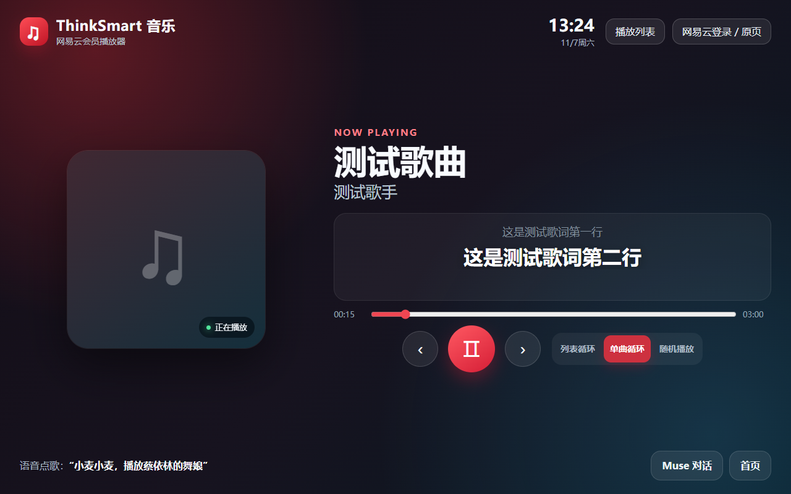
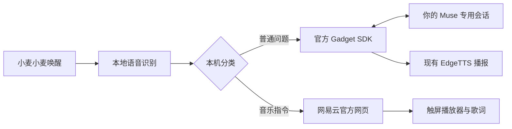

# 小麦 × Muse × 网易云音乐

把 **联想 ThinkSmart View CD-18781Y** 做成一台能聊天、能听歌的音箱。

说 **“小麦小麦，你好”**，回答来自你自己的 **Meta Muse 账号**。说 **“小麦小麦，播放蔡依林的舞娘”**，使用已登录的网易云官方网页播放。默认对话不经过 DeepSeek，也不需要它的 API Key。

这是现有 Ubuntu 语音镜像的**功能安装包**，不是新的刷机镜像。只包含下面两项：

| 功能 | 使用效果 |
| --- | --- |
| 个人 Muse 语音对话 | 本地唤醒、本地识别、Muse 专用会话、多轮文字回答转语音、打断本机等待 |
| 网易云音乐 | 语音点歌/暂停/继续/切歌；大按钮播放器、滚动歌词、播放列表、收藏与自建歌单、播放全部、列表循环/单曲循环/随机播放 |



上图为自动测试生成的界面预览，使用合成数据，不包含真实账号或歌曲内容。

**0.1.0 为首个实验版。** 基础功能已在一台约 2 GB 内存的实机上验收通过；公开版抽取、安装器和回退另有自动检查。全新刷机后从零安装尚未做第二台设备验收。准确的测试范围见 [验证记录](docs/VALIDATION.md)。

## 先准备什么

- **CD-18781Y**，已刷入 [HalfBit ThinkSmart Ubuntu 镜像](https://github.com/justhalfbit/thinksmart-ubuntu-image/releases/tag/20261101)，接好电源、连上 Wi-Fi。
- 镜像内的小智 Hub、语音客户端、屏幕浏览器正常安装；本地识别为 **SherpaXASR**，播报为 **EdgeTTS**。
- 能登录的 **Muse 手机 App 账号**，且账号能打开 Devices → Developer mode，以及 [SDK Token 页面](https://gadgets.muse.ai/settings/sdk-tokens)。只有模型 API Key 不能代替个人账号配对。
- 网易云音乐账号；能否完整播放取决于账号会员、单曲权限、地区和网易云网页版可用性。
- 音箱能够访问 GitHub、Muse 和 EdgeTTS；需要代理时，准备一个音箱能访问的 **HTTP 代理**。[网络说明](docs/NETWORK.md)

如果设备还在原厂系统，从 [基础镜像与首次连接](docs/BASE_IMAGE.md) 开始。首次刷机必须先完整备份原厂 eMMC。本项目不会自动刷机或改分区。

## 快速安装：已经刷好 Ubuntu 的设备

下面所有 Linux 命令都在**音箱的 SSH 窗口**执行。Windows 电脑打开 PowerShell，先运行 `ssh ubuntu@音箱IP`；看到 `ubuntu@thinksmarter:~$` 才继续。不会粘贴、密码输入无显示等问题见 [基础连接说明](docs/BASE_IMAGE.md)。

### 1. 下载并检查

```bash
sudo apt-get update
sudo apt-get install -y git curl ca-certificates
git clone --branch v0.1.0 --depth 1 https://github.com/StorK2025/thinksmart-muse-music.git
cd thinksmart-muse-music
sudo bash install.sh --check
```

看到 **“环境检查通过”** 再继续。它只检查环境，不安装组件、不更换模型、不读取或显示密码。

### 2. 安装

能直连 Muse：

```bash
sudo bash install.sh
```

音箱上已运行 Clash / Mihomo，HTTP 端口为 7890：

```bash
sudo bash install.sh --proxy http://127.0.0.1:7890
```

**两条选一条即可。** 安装会下载固定版本的官方 SDK、备份原配置、安装 Muse 接入及音乐界面，然后重启网关和屏幕。结束会显示 **“安装完成”** 及本机备份目录。初次下载速度取决于网络，没有配对前还不能回答。

安装器只适配本项目声明的基础镜像；发现别人手动安装的 Muse SDK 会停止，避免覆盖。已经按此前人工流程配置好的设备无需重装。

### 3. 连接自己的 Muse

在电脑浏览器打开 [Muse SDK Token 页面](https://gadgets.muse.ai/settings/sdk-tokens)，用自己的账号创建 Token。手机放在音箱旁边，然后在 SSH 窗口运行：

```bash
sudo thinksmart-muse-pair
```

只在出现 **“粘贴 Muse SDK Token”** 的提示后粘贴，按 Enter。输入不显示是正常的。**不要把 Token 当成命令单独执行，也不要发到聊天、Issue 或仓库。**

手机 Muse → **Settings → Devices → Developer mode → Add Device**，选择终端显示的 `MuseGadgetXXXXXX`。完成确认及网络步骤，终端看到 **`Paired.`** 即成功。失败可直接重试：

```bash
sudo thinksmart-muse-pair --resume
```

无需重新输入已保存的 Token。详见 [手机配对详细步骤与无终端 SSH 方案](docs/PAIRING.md)。

### 4. 登录网易云

屏幕默认显示音乐播放器。点右上角 **“网易云登录 / 原页”**，在网易云官方页面登录，推荐手机扫码；登录完成后点 **“返回音乐播放器”**。没有弹出键盘时，可点屏幕键盘按钮。

登录信息留在设备浏览器中，重启后保留。项目不收集密码、Cookie，不提供破解会员或下载歌曲功能。

### 5. 对着音箱试三句话

1. **“小麦小麦，你好，请用一句话介绍自己。”** 等待完整回答，无需说“问 Muse”。
2. **“小麦小麦，播放蔡依林的舞娘。”** 确认有声音和歌词。
3. **“小麦小麦，暂停音乐。”** 再说 **“小麦小麦，继续播放。”**

Muse 通常需要等待数秒到数十秒；语音来自原来的小麦播报，并非 Muse 原生实时语音通话。网易云首次打开、歌单较多或网络较慢时也需要载入时间。

## 平时怎么用

| 想做什么 | 说法或操作 |
| --- | --- |
| 聊天 | 小麦小麦 + 普通问题 |
| 点歌 | 小麦小麦，播放歌手的歌名 |
| 暂停 / 继续 | 暂停音乐 / 继续播放 |
| 切歌 | 下一首 / 上一首 |
| 结束聊天 | 小麦小麦，结束对话 |
| 看收藏和自建歌单 | 播放列表 → 我的歌单 → 点歌单 |
| 换成整个歌单 | 进入歌单后点“播放全部”，当前列表随之更新 |
| 改播放顺序 | 暂停键旁边选择列表循环、单曲循环或随机播放 |
| 调整语音与设备设置 | 底部“Muse 对话”进入原语音界面 |

普通音乐指令在本机识别，不需要 Muse 先转交。歌词、会员权限和歌单数据来自网易云官方网页；部分歌曲没有歌词或不能在网页版完整播放。离开音乐页面切到语音页面会释放旧页面，音乐随之停止；留在音乐页也可以唤醒小麦聊天。

## 出问题先做这一步

```bash
cd ~/thinksmart-muse-music
sudo bash install.sh --doctor
```

它只显示服务、配对和存储状态，不发送问题、不播放音频，也不打印 Token。然后按 [排错说明](docs/TROUBLESHOOTING.md) 查对应现象。

安装失败会尝试恢复原配置；手动恢复方法及保留哪些数据，见 [备份与恢复](docs/ROLLBACK.md)。需要网络代理时见 [网络说明](docs/NETWORK.md)。

## 实现方式与来源



本仓库站在这些项目之上：[系统镜像](https://github.com/justhalfbit/thinksmart-ubuntu-image)、[小麦语音客户端](https://github.com/justhalfbit/xiaozhi-thinksmart-client)、[小智 Hub](https://github.com/justhalfbit/xiaozhi-hub-server)、[Meta Muse Gadget SDK](https://github.com/facebookincubator/muse-gadget-sdk)。安装器不复制任何人的账号数据，也不分发包含登录状态的整机镜像。

详细组件、版本、SDK 适配及权限说明：[架构文档](docs/ARCHITECTURE.md)。本项目主体 MIT；SDK 衍生文件保持 Apache-2.0，上游署名和许可证见 [THIRD_PARTY.md](THIRD_PARTY.md)。这是社区适配，不是 Meta、网易云或联想官方产品；账号准入和服务规则由对应平台决定。
